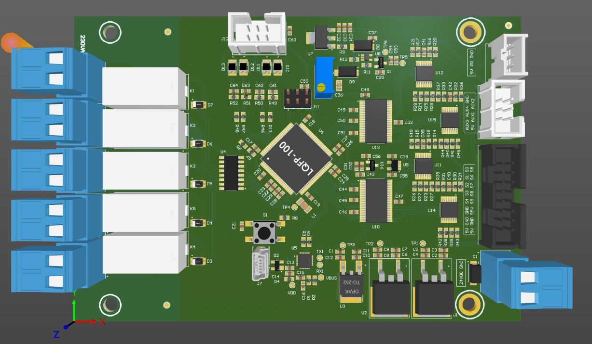
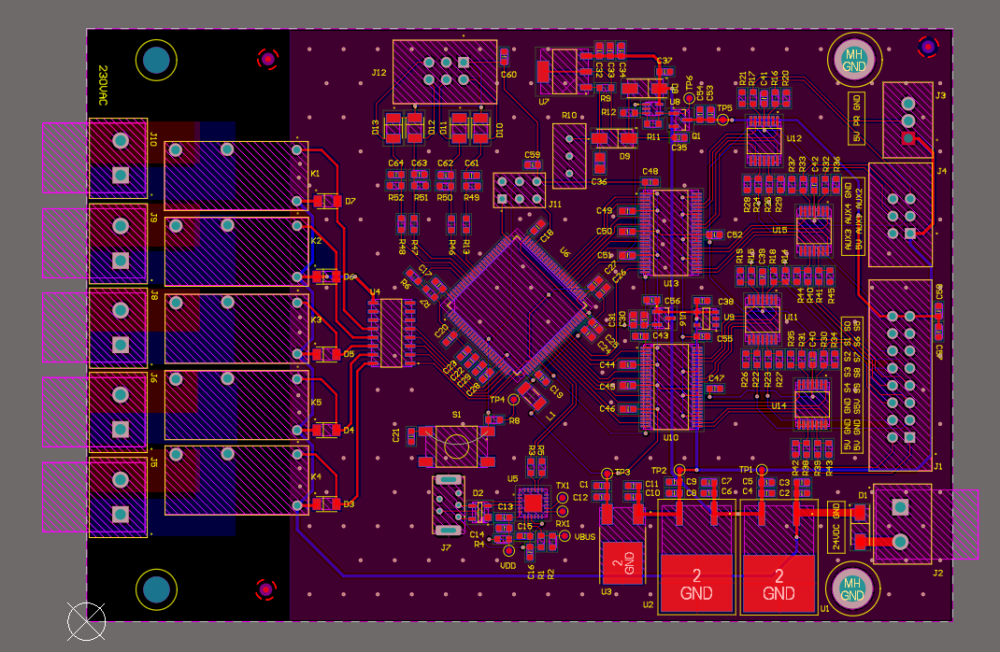

# STM32F373 Relay Control Board

Control board built around the STM32F373V8T6 microcontroller. It reads 16
analog inputs through op-amp buffers into the MCU's sigma-delta ADCs (SDADC1
and SDADC3), uses the DAC to set an adjustable sensor supply, and switches five
24 V relays. It runs from a 24 V input and talks to a PC over USB.

| 3D view | 2D layout |
| --- | --- |
| [](images/pcb-3d-view.png) | [](images/pcb-layout-2d.png) |

## On the board

| Ref | Part | Role |
| --- | --- | --- |
| U6 | STM32F373V8T6 | Microcontroller (SDADC1/SDADC3 inputs, DAC1 output, SWD) |
| U11, U12, U14, U15 | TLV9004IPWR | Quad op-amps buffering the 16 analog inputs (SENSOR0–9, AUX1–4, PRESSURE, SENSOR-5V-FB) |
| U10, U13 | PI3L301DAEX | Switches driven by the MCU `SELECT` line in the analog front end |
| U9 | REF4132A25DBVR | 2.5 V reference |
| U16 | REF3130AQDBZRQ1 | Voltage reference for the SDADC (`VREFSD+`) |
| U7, U8, Q1, R10 | LM317 + LMV321 + BC817 + 5 kΩ trimmer | Adjustable `SENSOR-5V` supply, set from `DAC1_OUT2` |
| U1, U2, U3 | L7812, L7805, LF33 | 12 V, 5 V and 3.3 V rails from the 24 V input |
| K1–K5 | HF46F/24-HS1TF | 24 V relays, contacts brought out on `RELAYCON1–10` |
| U4 | ULN2003AD | Relay coil driver (`DRIVE1–5` from the MCU) |
| D3–D7 | SS24FL | Relay coil flyback diodes |
| U5, J7 | CP2102N + USB connector | USB to UART bridge for the MCU |
| D2 | SP0503BAHTG | ESD protection on the USB lines |
| J2, J5, J6, J8–J10 | 2-way 5.08 mm pluggable terminal blocks | 24 V input and relay outputs |
| J1 | 5103308-3, 16-pin 2.54 mm header | Field connector |
| J4, J12 | 2-1761603-1 | Field connectors |
| J3, J11 | 1×3 and 2×3 headers | Programming / debug headers (the connector sheet carries `SWDIO`, `SWDCLK`, `NRST` and the USB lines) |
| S1 | FSM4JSMA push button | Push button |

## Repository layout

```
0007_stm32f373-relay-control/
├── PCB/                                       # Altium Designer project
│   ├── stm32f373-relay-control.PrjPcb         # Project file (open this)
│   ├── stm32f373-relay-control.SchDoc         # Top sheet
│   ├── Power Supply.SchDoc                    # 24 V -> 12 V / 5 V / 3.3 V
│   ├── Sensor Power Supply.SchDoc             # DAC-controlled sensor supply
│   ├── MCU.SchDoc                             # STM32F373
│   ├── OP AMPS.SchDoc                         # Analog front end
│   ├── Relays.SchDoc                          # Relay drivers
│   ├── USB.SchDoc                             # CP2102N USB-UART
│   ├── Connectors.SchDoc                      # Field connectors
│   ├── *.Harness                              # Signal harness definitions
│   ├── stm32f373-relay-control.PcbDoc         # PCB layout
│   ├── stm32f373-relay-control.PCBDwf         # Draftsman drawing
│   ├── OutJob.OutJob                          # Output job
│   └── Project Outputs for stm32f373-relay-control/
│       ├── PDF/                               # Schematic, PCB, assembly, BOM, 3D and mechanical PDFs
│       └── Design Rule Check - *.html         # DRC reports
└── images/                                    # Renders used in this README
```

## Component library

This repo stores no libraries. Every part comes from the general Altium library
in [Gueni/0000_libraries](https://github.com/Gueni/0000_libraries):

| File | Used for |
| --- | --- |
| [`Altium/DATABASE.DbLib`](https://github.com/Gueni/0000_libraries/blob/master/Altium/DATABASE.DbLib) | Database library the schematic components link to |
| [`Altium/DB.mdb`](https://github.com/Gueni/0000_libraries/blob/master/Altium/DB.mdb) | Parts database (part numbers, MPNs, suppliers) |
| [`Altium/SCH.SchLib`](https://github.com/Gueni/0000_libraries/blob/master/Altium/SCH.SchLib) | Schematic symbols |
| [`Altium/FTP.PcbLib`](https://github.com/Gueni/0000_libraries/blob/master/Altium/FTP.PcbLib) | PCB footprints and 3D models |

### Setup

The project finds the library through a relative path, so clone both repos side
by side in the same workspace folder:

```
WORKSPACE/
├── 0000_libraries/                   # git clone https://github.com/Gueni/0000_libraries.git
└── 0007_stm32f373-relay-control/     # this repo
```

The project file references `..\..\0000_libraries\Altium\DATABASE.DbLib` and
adds `..\..\0000_libraries\Altium\` as a library search path. The DbLib's
database path is absolute (`D:\WORKSPACE\0000_libraries\Altium\DB.mdb`); see the
[library README](https://github.com/Gueni/0000_libraries#setup) if your
workspace lives elsewhere.
